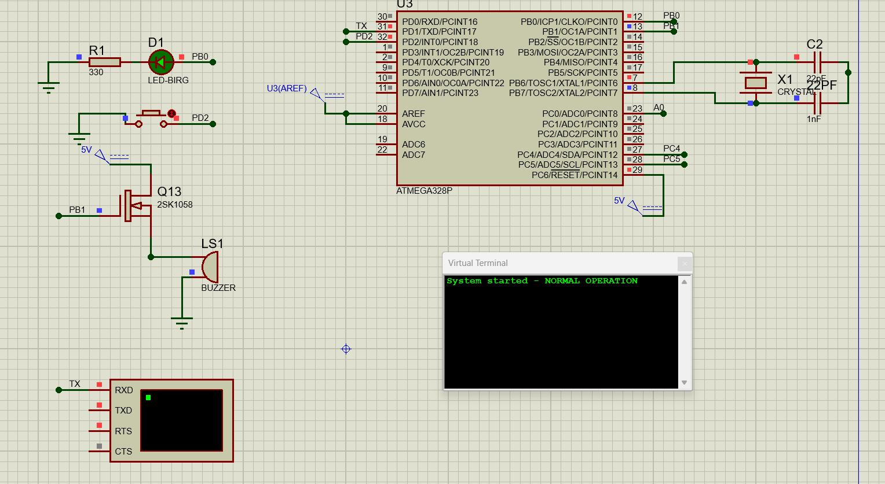
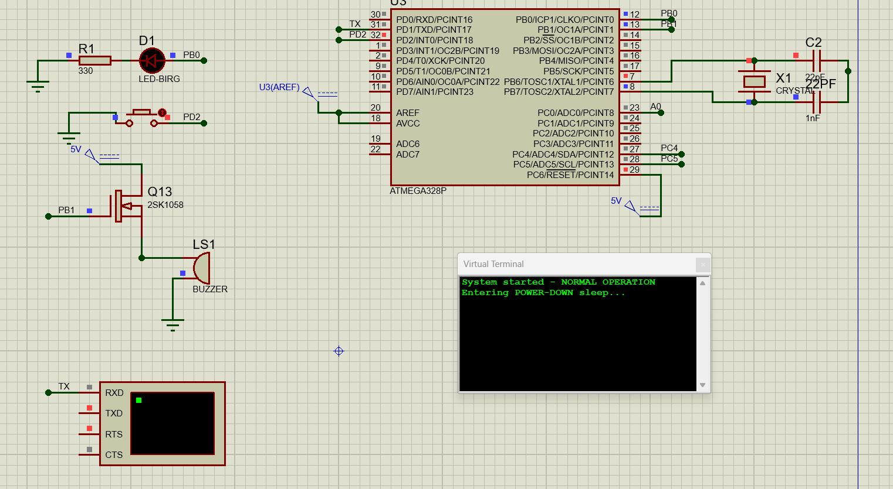
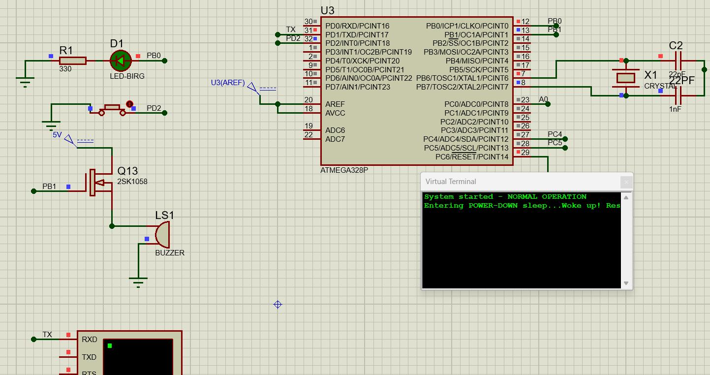
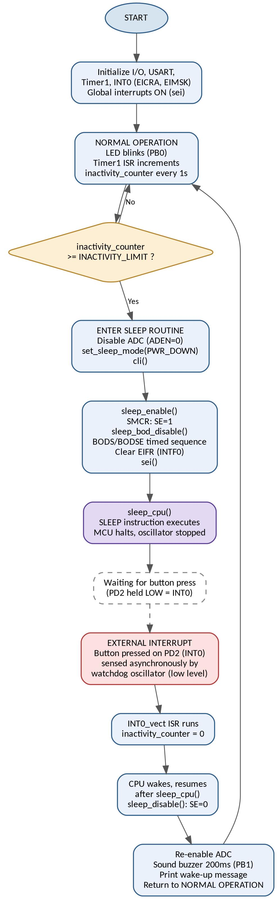
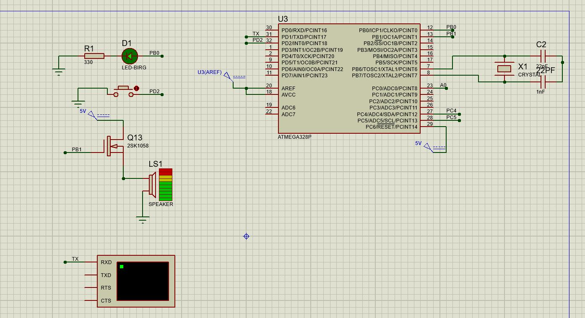

# ATmega328P Power-Down Sleep Mode with Interrupt Wake-Up

A low-power embedded system for the ATmega328P, written in bare-metal C and simulated in Proteus VSM. The LED blinks while the MCU is awake. After 5 seconds with no button press the firmware puts the chip into **Power-down**, the deepest sleep mode. Pressing a button wakes it through the external interrupt INT0, and the program resumes right after the sleep instruction, not from a reset.

## Demo

[`media/demo.mp4`](media/demo.mp4) is a short screen recording of the simulation: normal operation, entering sleep, and waking up.

| Normal operation | Power-down | Wake-up |
|---|---|---|
|  |  |  |

The Virtual Terminal prints `System started - NORMAL OPERATION`, then `Entering POWER-DOWN sleep...`, then `Woke up! Resuming normal operation.`

## How it works

1. **Normal operation:** the LED on PB0 blinks (300 ms on, 300 ms off). Timer1 fires once per second and increments an inactivity counter.
2. **Sleep:** when the counter reaches 5, the firmware turns the LED off, disables the ADC, selects Power-down mode and executes `SLEEP`. The CPU, main oscillator and Timer1 all stop.
3. **Wake-up:** pressing the button on PD2 pulls INT0 low. Low-level sensing is the only INT0 mode that works in Power-down, because edge detection needs a clock that is stopped. The ISR resets the counter, the program continues after `sleep_cpu()`, and the buzzer on PB1 beeps for 200 ms.



## Register-level details

| Register / bit | Purpose |
|---|---|
| `SMCR` (SM2:SM0 = 010, SE) | Select Power-down and arm the `SLEEP` instruction. `SE` is cleared again right after waking |
| `EICRA` (ISC01:ISC00 = 00) | INT0 triggers on a low level, the only sense mode that can wake Power-down |
| `EIMSK` (INT0) | Enable the INT0 interrupt |
| `EIFR` (INTF0) | Clear any stale pending flag before sleeping |
| `SREG` (I bit) | `cli()` while arming sleep to avoid a race, `sei()` just before `SLEEP`, since a wake-up needs interrupts enabled |
| `MCUCR` (BODS, BODSE) | Disable the brown-out detector during sleep (`sleep_bod_disable()`) to cut current |
| `ADCSRA` (ADEN) | Switch the ADC off during sleep, back on after waking |
| `TCCR1B`, `OCR1A`, `TIMSK1` | Timer1 in CTC mode, prescaler 1024, `OCR1A = 7812` for about 1 s at 8 MHz |
| `UBRR0`, `UCSR0B/C` | USART at 9600 baud (UBRR = 51 at 8 MHz), transmit only, for status messages |

`PRR` is deliberately not used. In Power-down the main clock is already stopped, so there is nothing for it to gate.

## Circuit (Proteus)



| Part | Connection |
|---|---|
| LED (with 330 Ω resistor) | PB0 |
| Push button | PD2 (INT0), internal pull-up enabled |
| Buzzer | PB1, switched through MOSFET Q13 (2SK1058) |
| Crystal | 8 MHz on XTAL1/XTAL2 with load capacitor |
| Virtual Terminal | PD0/PD1 (USART) |

## Run it

1. Compile `src/main.c` with `avr-gcc` for the ATmega328P with `F_CPU=8000000UL`, or build it in your preferred AVR toolchain, and produce a `.hex` file.
2. Open `proteus/sleep-modes.pdsprj` in Proteus, load the `.hex` into the ATmega328P, and run the simulation. Press the button to wake the chip once it has gone to sleep.

The timing values (`F_CPU`, the USART divisor and `OCR1A`) assume an **8 MHz** clock. For a 16 MHz board they would need to be recalculated.

## Repository layout

```
src/main.c                 firmware
proteus/sleep-modes.pdsprj Proteus simulation project
docs/                      circuit, flowchart and simulation screenshots
media/demo.mp4             simulation screen recording
```

## Tech

C (avr-libc), ATmega328P, Proteus VSM.
